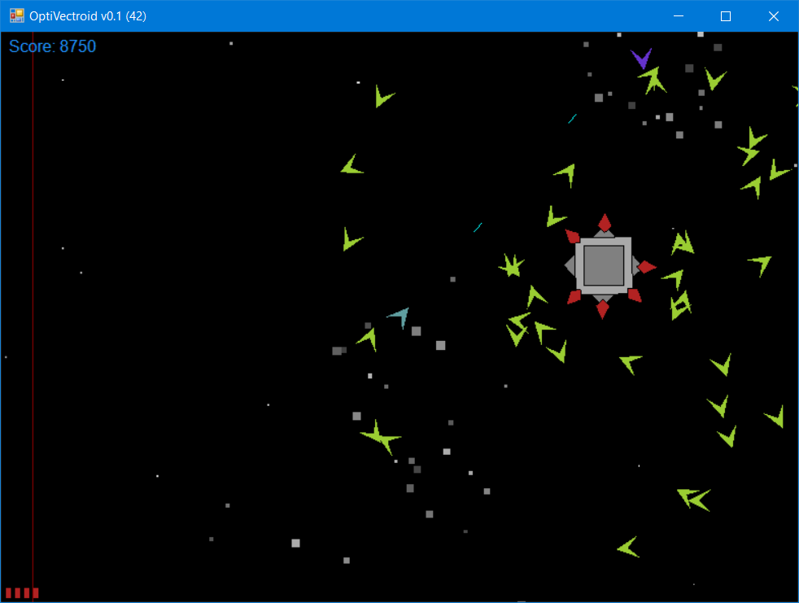

# OptiVectroid

## About

OptiVectroid V0.1  
November 2008  
Created by Taber (the last days of OptiFrame Software)

(Screenshot of OptiVectroid game being played.)

## Game Play

Primary Keys:
* Left/Right - Steer Ship
* Up/Down - Throttle
* Control - Fire
* End - Flip Ship
* P - Pause Game
* R - Reset Game
* M - Toggle Display of Mouse
* Z - Cycle Zoom Levels
* Escape/Q - Exit Game

Other Keys:
* '+' - Add ship
* '-' - Subtract ship
* 0 - Clear all ships
* A - Auto-Pilot
* F - Formation Flying
* X - Toggle Destructor (big enemy thingy)
* D - Debug Info Display
* I - Show Frame-Rate
* B - Cycle Background Color

(Original 2002-2008 OptiFrame Software logi image.)

